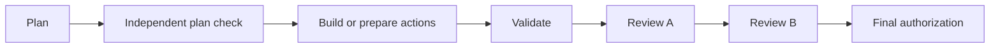

# Automatic task workflow

New tasks started from Mission Control's task runner use automatic plan checking and two independent reviews. The planner still writes a readable, versioned plan; a fresh agent using a different model checks that plan against the task's requirements, existing implementation and scope. A passing check enables implementation without a human plan decision. It is recorded as machine acceptance, never as human approval.

The checker should accept a sufficient, maintainable plan. Repairs need concrete missing requirements, incorrect assumptions or unnecessary complexity; extra features and speculative abstractions are not a reason to keep iterating. Gortex remains required for indexed repository evidence. Existing patterns, user changes, acceptance criteria and non-goals remain binding.

## Reviews and validation

Validation runs before either reviewer. For code this means the relevant existing tests, type checks, builds and other checks selected in the plan, with their actual outcomes tied to the current candidate. A green badge or previous revision's checks cannot stand in for fresh evidence.

Both code reviewers use OCR for file selection and rules, and Gortex for repository context. They reason independently in fresh sessions using different normalized models. They run sequentially; the second reviewer does not read the first review's conclusions before submitting its own verdict. Both must cover the same validated candidate. Missing OCR evidence, an unavailable required model, a changed candidate, open findings or incomplete host information block automatic delivery.

Substantiated findings return to the builder. Fixes require validation and both reviews of the revised candidate. Plan repairs and implementation repairs each have a limit of two automatic attempts. Unresolved requirements, missing authority, scope changes or exhausted repair attempts become questions or blockers for the user. The flow does not turn failed tests or permission requests into silent model fallback.

## Final decision

Automatic tasks do not request routine human plan or code-review approval. Publication still requires an explicit final decision covering the prepared commit, push, draft pull request or other outward action. The existing delivery preview and fingerprint checks remain in force. Selecting automatic mode does not authorize tracker comments, merges, deployments or production actions.

For a task with no code changes, select **Actions** or **Report** when starting it:

- **Actions:** the builder saves an immutable bundle containing the environment, prerequisites, exact commands or steps, expected effects, verification and rollback. Validation uses safe local checks or dry runs where available; it does not execute the proposed external changes. Two independent models review the bundle. The user then authorizes that exact reviewed version. Mission Control resumes the assigned worker with the authorized steps; it is not a general shell executor. A changed bundle needs fresh checks, reviews and authorization. An uncertain send is shown for inspection, never blindly retried.
- **Report:** the same evidence and dual-review requirements apply to the saved read-only result. It can finish without an action authorization. Its report is available in the final preview.

OCR's code-diff coverage applies to code changes. Non-code reviewers inspect the saved bundle directly and record artifact coverage; they must not fabricate an OCR receipt.

## Pages focused on your next action

**Needs you** replaces the old Mission Control v2 preview. It groups questions, work ready to publish, actions ready to execute and problems that need intervention. Older tasks that still require manual approvals are labelled separately. Each task appears once with its host, a plain explanation and a next action. Unavailable or incomplete hosts are visibly unconfirmed, never reported as clear of work.

**All work** keeps four board columns: Up next, Working, Needs you and Done. Planning, plan checks, implementation, validation and independent reviews belong to Working until there is a real question or final decision for you.

**Ready to publish** opens the existing code browser and comment tools. You can inspect changes and save file or line comments before opening the separate publication preview. If fixes are needed, use **Request fixes before continuing**. You can copy open workspace comments into the request, review the wording, then send it. An explicit request blocks publication and returns the task to its remaining repair attempts; it requires fresh implementation, validation and both reviews. Saved draft comments alone do not create a repair request. The request records the exact work, plan and displayed code comparison, so an outdated screen cannot silently request fixes against a different version.

**Ready to execute** shows the reviewed environment, actions, effects, checks and recovery steps. Request changes when needed, or authorize only the exact displayed actions. Reports do not ask you to authorize execution.

## Profiles and existing tasks

Automatic mode uses the host/project/task profile mapping. It requires two different review models even if the saved manual setting requests only one reviewer. Unless a separate plan-check profile is selected, it derives the plan checker from a mapped reviewer with a different model from the planner. Models and reasoning settings are not changed by enabling the workflow.

Existing records without a workflow mode remain manual, retaining their approval history and policy identity. To adopt the automatic flow for an existing task, use **Switch to automatic plan check and two reviews** on an eligible paused or waiting runner. The server requires a complete fresh host view, no active worker or unresolved dispatch and no open human decision; adoption restarts planning and does not manufacture approval of an old plan.

Questions and final authorization remain visible in Mission Control. Host heartbeats and provider permissions retain their current settings. The task runner operates while its host and Paseo are awake; it cannot guarantee progress through disconnections, provider limits or unavailable tooling.
