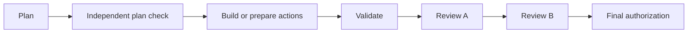

# Automatic task workflow

New tasks use automatic plan checking and two independent reviews whenever an orchestrator chat manages the task's host. This applies however the task starts: a task's **Start automatic workflow** button, an orchestrator's `start` command, the chat command `run to draft PR <task ID>`, or Orchestrator → Run a task. The manual workflow remains only where no orchestrator manages the host, such as the coordinating computer's own tasks. The planner still writes a readable, versioned plan; a fresh agent using a different model checks that plan against the task's requirements, existing implementation and scope. A passing check enables implementation without a human plan decision. It is recorded as machine acceptance, never as human approval.

The checker should accept a sufficient, maintainable plan. Repairs need concrete missing requirements, incorrect assumptions or unnecessary complexity; extra features and speculative abstractions are not a reason to keep iterating. Gortex remains required for indexed repository evidence. Existing patterns, user changes, acceptance criteria and non-goals remain binding.

## Queue and worktrees

Each host keeps a queue of automatic tasks in the order they were started, so start the most urgent work first. Each host runs one stage at a time, and different hosts run in parallel. A task's stages are at least five minutes apart, so another task on the same host can take a free slot in between.

Before planning, a code task gets its own worktree and branch, created the way Start creates one. The branch follows the project's branch-name template, using its feature option when the ticket type is unknown. Its changes never mix with other tasks' work in the project checkout, and its draft PR is published from that branch. If the worktree can't be created, the task is blocked with the reason until you resume it.

## Reviews and validation

Validation runs before either reviewer. For code this means the relevant existing tests, type checks, builds and other checks selected in the plan, with their actual outcomes tied to the current candidate. A green badge or previous revision's checks cannot stand in for fresh evidence.

Both code reviewers use OCR for file selection and rules, and Gortex for repository context. They reason independently in fresh sessions using different normalized models. They run sequentially; the second reviewer does not read the first review's conclusions before submitting its own verdict. Both must cover the same validated candidate. Missing OCR evidence, an unavailable required model, a changed candidate, open findings or incomplete host information block automatic delivery.

Substantiated findings return to the builder. Fixes require validation and both reviews of the revised candidate. Plan repairs and implementation repairs each have a limit of two automatic attempts. Unresolved requirements, missing authority, scope changes or exhausted repair attempts become questions or blockers for the user. The flow does not turn failed tests or permission requests into silent model fallback.

## Final decision

Automatic tasks do not request routine human plan or code-review approval. Publication still requires an explicit final decision covering the prepared commit, push, draft pull request or other outward action. The existing delivery preview and fingerprint checks remain in force. Selecting automatic mode does not authorize tracker comments, merges, deployments or production actions.

For a task with no code changes, select **Actions** or **Report** when starting it:

- **Actions:** the builder saves an immutable bundle containing the environment, prerequisites, exact commands or steps, expected effects, verification and rollback. Validation uses safe local checks or dry runs where available; it does not execute the proposed external changes. Two independent models review the bundle. The user then authorizes that exact reviewed version. Mission Control resumes the assigned worker with the authorized steps; it is not a general shell executor. A changed bundle needs fresh checks, reviews and authorization. An uncertain send is shown for inspection, never blindly retried.
- **Report:** the same evidence and dual-review requirements apply to the saved read-only result. It can finish without an action authorization. Its report is available in the final preview.

OCR's code-diff coverage applies to code changes. Non-code reviewers inspect the saved bundle directly and record artifact coverage; they must not fabricate an OCR receipt.

## Pages focused on your next action

**Needs you** replaces the old Mission Control v2 preview. It groups questions, work ready to publish, actions ready to execute and problems that need intervention. Older tasks that still require manual approvals are labelled separately. Each task appears once with its host, a plain explanation and a next action. Unavailable or incomplete hosts are visibly unconfirmed, never reported as clear of work.

On the coordinating computer, Needs you and All work cover every host its orchestrator folders bind. On a computer that coordinates no other host, for example a remote host's own Paseo app, they show that computer's own Mission Control work as "This computer".

**All work** keeps four board columns: Up next, Working, Needs you and Done. Planning, plan checks, implementation, validation and independent reviews belong to Working until there is a real question or final decision for you.

**Ready to publish** opens the existing code browser and comment tools. You can inspect changes and save file or line comments before opening the separate publication preview. If fixes are needed, use **Request fixes before continuing**. You can copy open workspace comments into the request, review the wording, then send it. An explicit request blocks publication and returns the task to its remaining repair attempts; it requires fresh implementation, validation and both reviews. Saved draft comments alone do not create a repair request. The request records the exact work, plan and displayed code comparison, so an outdated screen cannot silently request fixes against a different version.

**Ready to execute** shows the reviewed environment, actions, effects, checks and recovery steps. Request changes when needed, or authorize only the exact displayed actions. Reports do not ask you to authorize execution.

## Profiles and existing tasks

Automatic mode uses the host/project/task profile mapping. It requires two different review models even if the saved manual setting requests only one reviewer. Unless a separate plan-check profile is selected, it derives the plan checker from a mapped reviewer with a different model from the planner. Models and reasoning settings are not changed by enabling the workflow.

Existing records without a workflow mode remain manual, retaining their approval history and policy identity. You can switch an existing task to the automatic flow in three ways:

- **Switch to automatic (retires open approvals)** in Orchestrator → Run a task;
- the chat command `automate pipeline <task ID>`;
- `start --adopt` from the orchestrator's command line.

The switch is one guarded step. It requires a complete fresh host view and nothing working or waiting for permission on the task.

- The task's open plan and code-review requests are marked **superseded**. They are never approved, and no message goes to the old worker. Each keeps a note saying it was retired by the switch.
- Planning restarts with a fresh independent plan check, followed by validation and both reviews.
- The task's earlier workers no longer hold up new stages, even when they are archived or errored. Anything still working in the task's worktree does.

The switch never overrides your own stop or change request. It also refuses a code run that works in the shared project checkout, because a draft PR can only be published from the task's own branch. Finish such tasks on the old flow, or start a new automatic task.

An open question whose worker has since been archived can still be answered. The answer is saved on the task for its next worker, which reads it through `dev-flow context`. To close a question that no longer matters, answer with the reason.

Questions and final authorization remain visible in Mission Control. Host heartbeats and provider permissions retain their current settings. The task runner operates while its host and Paseo are awake; it cannot guarantee progress through disconnections, provider limits or unavailable tooling.
